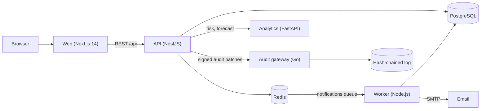

<div align="center">

# Clearpath

**Care coordination and operations for referrals, pathways, prior authorizations, capacity and staffing.**

[](https://github.com/your-org/Clearpath/actions/workflows/ci.yml)
[](LICENSE)
[](https://www.typescriptlang.org/)
[](https://nestjs.com/)
[](https://nextjs.org/)
[](https://www.python.org/)
[](https://go.dev/)
[](https://www.prisma.io/)
[](https://nodejs.org/)

</div>

---

## Overview

Care teams lose time between systems: a referral sits unseen, an authorization lapses, a bed is double-booked, a shift breaks a rest rule. Clearpath puts those workflows in one platform so coordinators, clinicians, schedulers and bed managers work from the same live picture, and so every access and change is auditable.

The repository is a monorepo: a NestJS API on PostgreSQL and Redis, a Next.js 14 web app, a Node worker for reminders and notifications, a small FastAPI service for risk scoring and capacity forecasting, and a Go gateway that ingests signed audit events into a tamper-evident chain.

## Key features

- **Patient referrals** with a validated state machine, a triage queue ordered by clinical priority and waiting time, and SLA breach flags.
- **Care pathways** with ordered steps, per-step due dates and patient enrollments that advance step by step.
- **Prior authorizations** with payer decision flow, required denial reasons, event history and expiry reminders.
- **Provider directory** searchable by name, NPI, specialty and network status.
- **Bed and capacity management** with atomic admission (no double-booking), cleaning workflow, surge levels and ward forecasts.
- **Staff scheduling** that rejects overlaps, over-long shifts, weekly-hour overruns and short rest periods.
- **Clinical task boards** with SLA-derived due dates, status columns and comments.
- **Audit trails** for reads and writes, CSV export (itself audited), and a hash-chained gateway store.
- **Analytics** for time-to-triage, authorization approval rates and payer turnaround, plus an explainable readmission risk score.
- **Role-based access** for administrators, coordinators, clinicians, schedulers, bed managers, analysts and auditors.

## Architecture



See [docs/architecture.md](docs/architecture.md) for request flow, failure behavior and design notes.

## Tech stack

| Layer | Technology |
| ----- | ---------- |
| API | Node.js 20, TypeScript, NestJS 10, class-validator, JWT, Swagger |
| Web | Next.js 14 App Router, React 18, TypeScript |
| Database | PostgreSQL 16, Prisma 5 (29 models, 12 enums) |
| Cache and queues | Redis 7 |
| Worker | Node.js (plain JavaScript), ioredis, pg, nodemailer |
| Analytics | Python 3.12, FastAPI, Pydantic |
| Audit gateway | Go 1.22 (standard library only) |
| Testing | Jest and supertest, pytest, go test |
| Delivery | Docker, Docker Compose, Kubernetes manifests, GitHub Actions |

## Repository layout

```text
Clearpath/
├── apps/
│   ├── api/                 NestJS API (domain modules, guards, interceptors, specs)
│   │   ├── src/
│   │   │   ├── auth/ common/ config/ health/
│   │   │   ├── patients/ providers/ specialties/ coverages/ insurance-plans/
│   │   │   ├── referrals/ pathways/ authorizations/
│   │   │   ├── wards/ beds/ staff/ shifts/ task-boards/ tasks/
│   │   │   ├── facilities/ users/ notifications/ audit/ analytics/
│   │   │   ├── app.module.ts
│   │   │   └── main.ts
│   │   └── test/            supertest suites
│   ├── web/                 Next.js app (src/app, components, hooks, lib)
│   └── worker/              Queue consumers and scheduled jobs
├── packages/
│   ├── shared-types/        Types shared by web and API
│   ├── shared-utils/        Date and identifier helpers
│   └── ui/                  Presentational components
├── prisma/
│   ├── schema.prisma
│   ├── seed.ts
│   └── migrations/          Timestamped folders and migration_lock.toml
├── services/
│   ├── analytics/           FastAPI risk and forecast service (pytest)
│   └── audit-gateway/       Go audit ingestion gateway (go test)
├── scripts/                 Dev, environment and maintenance scripts
├── deploy/                  Dockerfiles, compose, nginx, Kubernetes manifests
├── docs/                    Architecture, API, data model, security, deployment, runbook, ADRs
├── .github/                 Workflows, issue and PR templates, Dependabot, CODEOWNERS
├── Makefile
├── package.json
└── .env.example
```

## Getting started

Prerequisites: Node 20, Python 3.12, Go 1.22 and Docker.

```bash
cp .env.example .env
make install        # npm install, prisma generate, pip and go dependencies
make db-up          # PostgreSQL and Redis via Docker Compose
make db-migrate     # prisma migrate deploy
make db-seed        # invented organization, users, patients, providers, beds
make check-env      # verify required variables
make dev            # API :4000, web :3000, worker
```

Optional side services:

```bash
make analytics      # FastAPI on :8100 (ANALYTICS_URL)
make gateway        # Go gateway on :8200 (AUDIT_GATEWAY_URL, AUDIT_GATEWAY_SIGNING_KEY)
```

Or run everything in containers with `make docker-up`.

Key variables from `.env.example`: `DATABASE_URL`, `REDIS_URL`, `JWT_ACCESS_SECRET`, `JWT_REFRESH_SECRET`, `ANALYTICS_URL`, `AUDIT_GATEWAY_URL`, `AUDIT_GATEWAY_SIGNING_KEY`, `SMTP_HOST`, `REMINDER_LEAD_HOURS`, `AUTH_EXPIRY_WARNING_DAYS`.

Seeded sign-ins use `*.example` addresses (for example `coordinator@clearpath.example`); the password is printed by `make db-seed`.

## API overview

All routes live under `/api`; Swagger UI is served at `/api/docs`. A representative subset (the full list is in [docs/api.md](docs/api.md)):

| Method | Path | Roles | Description |
| ------ | ---- | ----- | ----------- |
| POST | `/api/auth/login` | public | Exchange credentials for an access and refresh token |
| POST | `/api/auth/refresh` | public | Rotate a refresh token |
| GET | `/api/patients` | any | List patients (paginated, filterable) |
| GET | `/api/patients/:id/timeline` | varies | Merged referral, authorization and task timeline |
| GET | `/api/providers` | any | List providers (paginated, filterable) |
| POST | `/api/referrals` | ADMIN, COORDINATOR, CLINICIAN, SCHEDULER | Create |
| GET | `/api/referrals/queue/triage` | varies | Triage queue ordered by priority then waiting time, with SLA flags |
| POST | `/api/referrals/:id/transition` | varies | Move through the state machine (validated server-side) |
| POST | `/api/authorizations/:id/transition` | varies | Move through the state machine (validated server-side) |
| GET | `/api/authorizations/expiring` | varies | Approved authorizations expiring within N days |
| GET | `/api/pathways` | any | List care pathways (paginated, filterable) |
| POST | `/api/pathways/:id/enroll` | varies | Enroll a patient |
| GET | `/api/wards/overview/occupancy` | varies | Occupancy per ward |
| GET | `/api/beds/available/search` | varies | Available beds filtered by isolation or telemetry |
| POST | `/api/beds/:id/admit` | varies | Atomically admit a patient to a bed |
| POST | `/api/beds/:id/discharge` | varies | Discharge and move the bed to cleaning |
| POST | `/api/shifts` | ADMIN, SCHEDULER | Create |
| GET | `/api/task-boards/:id/summary` | varies | Status counts and overdue tasks |
| GET | `/api/tasks/mine/open` | varies | Open tasks assigned to the caller |
| PATCH | `/api/tasks/:id/status` | varies | Change bed or task status |
| GET | `/api/notifications` | any | List the caller's notifications |
| GET | `/api/audit` | ADMIN, AUDITOR | Search the audit trail |
| GET | `/api/audit/export` | ADMIN, AUDITOR | CSV export (itself audited) |
| GET | `/api/analytics/overview` | ADMIN, ANALYST, COORDINATOR, BED_MANAGER | Dashboard headline numbers |
| GET | `/api/analytics/referral-funnel` | ADMIN, ANALYST, COORDINATOR, BED_MANAGER | Time-to-triage and scheduling statistics |
| GET | `/api/analytics/wards/:wardId/forecast` | ADMIN, ANALYST, COORDINATOR, BED_MANAGER | Occupancy forecast (analytics service) |
| GET | `/api/analytics/patients/:id/risk` | ADMIN, ANALYST, CLINICIAN, COORDINATOR | Readmission risk score |

## Data model summary

Twenty-nine Prisma models across four areas, with timestamped migrations:

| Area | Models |
| ---- | ------ |
| Identity and directory | Organization, Facility, Department, User, RefreshToken, Specialty, Provider, ProviderSpecialty, InsurancePlan |
| Referrals and authorizations | Patient, Coverage, Referral, ReferralNote, CarePathway, PathwayStep, PathwayEnrollment, PriorAuthorization, AuthorizationEvent |
| Capacity and staffing | Ward, Bed, BedAssignment, StaffMember, Shift |
| Tasks, audit and analytics | TaskBoard, Task, TaskComment, AuditLog, Notification, RiskScore |

Details, indexes and an ER diagram are in [docs/data-model.md](docs/data-model.md).

## Testing

```bash
make test               # Jest (API, worker, utilities, web helpers), pytest, go test
npm run test:cov        # Jest with coverage thresholds
make lint               # ESLint
```

Business rules (referral transitions, authorization expiry, bed capacity, shift validation, task SLAs, pathway progress) are pure functions with dedicated specs; services are tested against mocked Prisma clients.

## Deployment

- **Compose**: `make docker-up` builds all images from `deploy/` and the service folders.
- **Kubernetes**: manifests in `deploy/k8s/` with a shared config map and secret.
- **CI/CD**: GitHub Actions for CI, CodeQL, lint, migration drift checks, Docker images and releases.

Run `npx prisma migrate deploy` before rolling out a new API version. See [docs/deployment.md](docs/deployment.md) and [docs/runbook.md](docs/runbook.md).

## Security

Clearpath provides role-based access, audited reads and writes, hashed credentials, rotating refresh tokens, request validation, rate limiting and a signed, hash-chained audit store. It does not claim certification or compliance with any regulation; operators remain responsible for encryption at rest, key management, network policy, retention and governance. See [docs/security.md](docs/security.md) and [SECURITY.md](SECURITY.md).

## Roadmap

- Row-level access rules (assigned-clinician visibility).
- Single sign-on and multi-factor authentication through an external identity provider.
- Payer connectivity for electronic authorization submission.
- Shift swap and open-shift marketplace.
- Recalibration tooling for the risk model from local outcomes.
- External anchoring of the audit chain head.

## Contributing

Contributions are welcome. Read [CONTRIBUTING.md](CONTRIBUTING.md) and the [Code of Conduct](CODE_OF_CONDUCT.md), and never include real patient data in issues or pull requests. Repository: https://github.com/your-org/Clearpath

## License

Released under the [MIT License](LICENSE).
