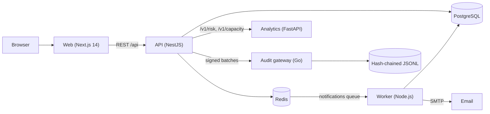

# Architecture

Clearpath is a monorepo of five runtime components around a single PostgreSQL database.

## Components

| Component | Path | Responsibility |
| --------- | ---- | -------------- |
| Web | `apps/web` | Next.js App Router UI for coordinators, clinicians, schedulers, bed managers, analysts and auditors |
| API | `apps/api` | Business rules, authentication, authorization, audit, persistence through Prisma |
| Worker | `apps/worker` | Notification delivery, triage reminders, authorization expiry, capacity snapshots |
| Analytics | `services/analytics` | Readmission risk scoring and ward occupancy forecasting |
| Audit gateway | `services/audit-gateway` | Signed audit event ingestion with a tamper-evident hash chain |
| Shared packages | `packages/*` | Types shared by web and API, pure utilities, presentational components |

## API structure

The NestJS application is organized by domain module. Each module has a controller (routing, role metadata), a service (queries and orchestration), DTOs (class-validator), and a unit spec. Business rules that benefit from isolation are pure functions with their own specs:

- `referrals/referral-state.ts`: transition table, triage ordering, SLA breach detection.
- `authorizations/auth-rules.ts`: transition table, expiry classification, decision validation.
- `beds/capacity.ts`: occupancy summaries, surge levels, bed matching.
- `shifts/shift-rules.ts`: overlap, weekly hours, rest period validation.
- `tasks/sla.ts`: SLA state and default due dates.
- `pathways/pathway-progress.ts`: step due dates and progress.

Cross-cutting concerns are global providers registered in `app.module.ts`: JWT guard, roles guard, throttler, logging interceptor and the audit interceptor. A request-id middleware tags every request.

## Request lifecycle

1. `RequestIdMiddleware` assigns or accepts an `X-Request-Id`.
2. `ThrottlerGuard`, `JwtAuthGuard` and `RolesGuard` run in that order; routes marked `@Public()` skip authentication.
3. The validation pipe whitelists and transforms the body or query into a DTO.
4. The controller delegates to a service that talks to Prisma.
5. `AuditInterceptor` records the action for controllers marked `@Audited(...)`, and `HttpExceptionFilter` shapes errors.

## Data flow examples

**Referral to appointment.** A coordinator submits a referral; it enters `SUBMITTED`. The triage queue endpoint sorts by priority then age and flags SLA breaches. Triage stamps `triagedAt`; scheduling requires an appointment time and optionally a provider. The worker's hourly job pushes a digest to coordinators for referrals past their triage target.

**Authorization expiry.** The worker queries approved authorizations nearing `validUntil`, enqueues one notification per bucket (warning, final, expired) using a Redis dedupe key, and marks lapsed ones `EXPIRED` with a system event.

**Capacity forecast.** The API assembles 28 days of occupancy history for a ward from bed assignments and sends it to the analytics service, which returns an interval forecast and the days expected to reach 90% or more.

## Failure behavior

- If the analytics service is unreachable, risk scoring falls back to a local heuristic and is labelled `local-fallback`.
- If the audit gateway is unreachable, events remain in the PostgreSQL audit table (the system of record); forwarding is best effort.
- Worker jobs retry with exponential backoff and are parked on `queue:<name>:dead` after the maximum attempts.

## Scaling notes

The API is stateless and scales horizontally. The worker should run as a single replica unless job deduplication is extended. Audit tables grow quickly; see the runbook for pruning and partitioning guidance.
