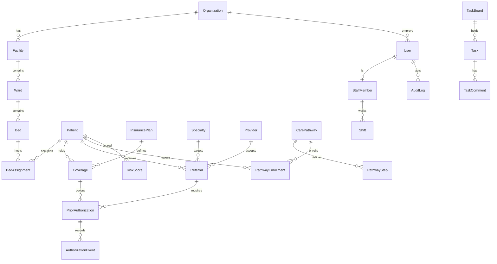

# Data model

The schema lives in `prisma/schema.prisma` and is applied through the timestamped folders in `prisma/migrations/`. There are 29 models and 12 enums. Tables use snake_case plural names via `@@map`; columns keep Prisma field names.

## Entity overview

## Models by area

### Identity and directory
`Organization`, `Facility`, `Department`, `User`, `RefreshToken`, `Specialty`, `Provider`, `ProviderSpecialty`, `InsurancePlan`.

- Users belong to an organization and carry one `UserRole`. Passwords are bcrypt hashes; refresh tokens are stored only as SHA-256 digests with an expiry and revocation time.
- Providers have a unique NPI, a `NetworkStatus`, and a many-to-many link to specialties (one marked primary).

### Patients, referrals, pathways and authorizations
`Patient`, `Coverage`, `Referral`, `ReferralNote`, `CarePathway`, `PathwayStep`, `PathwayEnrollment`, `PriorAuthorization`, `AuthorizationEvent`.

- `Referral.reference` is unique and human readable (`REF-YYMM-XXXXXX`). Timestamps `triagedAt`, `scheduledAt` and `closedAt` capture state-machine progress and feed analytics.
- `PriorAuthorization` ties a patient, a coverage and optionally a referral. `AuthorizationEvent` is an append-only history of status changes.
- `PathwayEnrollment` is unique per patient and pathway, and tracks `currentStep`.

### Capacity and staffing
`Ward`, `Bed`, `BedAssignment`, `StaffMember`, `Shift`.

- `Bed` is unique per ward and label with a `BedStatus`. `BedAssignment.dischargedAt IS NULL` marks the active stay.
- `StaffMember` stores `maxWeeklyHours`, which the shift validator enforces.

### Tasks, audit and analytics
`TaskBoard`, `Task`, `TaskComment`, `AuditLog`, `Notification`, `RiskScore`.

- `AuditLog` records actor, action, entity type and id, IP, request id and JSON metadata. It is indexed by entity and by actor and time.
- `RiskScore` keeps every computed score with the model name and factor breakdown for later review.

## Enums

`UserRole`, `ReferralStatus`, `ReferralPriority`, `AuthStatus`, `BedStatus`, `WardType`, `TaskStatus`, `TaskPriority`, `ShiftStatus`, `PathwayStatus`, `NetworkStatus`, `AuditAction`.

## Indexing strategy

- Work queues: `referrals(status, priority, createdAt)`, `tasks(boardId, status)`, `tasks(assigneeId, status)`, `prior_authorizations(status, validUntil)`.
- Lookup: `patients(lastName, firstName)`, `providers(lastName, firstName)`, `providers(networkStatus, acceptingNew)`.
- Time ranges: `shifts(startsAt, endsAt)`, `audit_logs(createdAt)`.

## Migrations

| Folder | Contents |
| ------ | -------- |
| `20260115090000_init_identity_directory` | Enums, organizations, facilities, users, providers, insurance plans |
| `20260304101500_referrals_pathways_authorizations` | Patients, coverage, referrals, pathways, authorizations |
| `20260520083000_capacity_staffing` | Wards, beds, assignments, staff, shifts |
| `20260812141000_tasks_audit_analytics` | Task boards, tasks, audit log, notifications, risk scores |

`scripts/verify-migrations.js` and the `migrations-check` workflow guard naming, ordering and drift. Migrations are forward-only.

## Seed data

`prisma/seed.ts` creates an organization, two facilities, seven role-based accounts on `*.example` addresses, invented patients, providers, a pathway, a ward with beds, shifts and a task board. It contains no real data.
